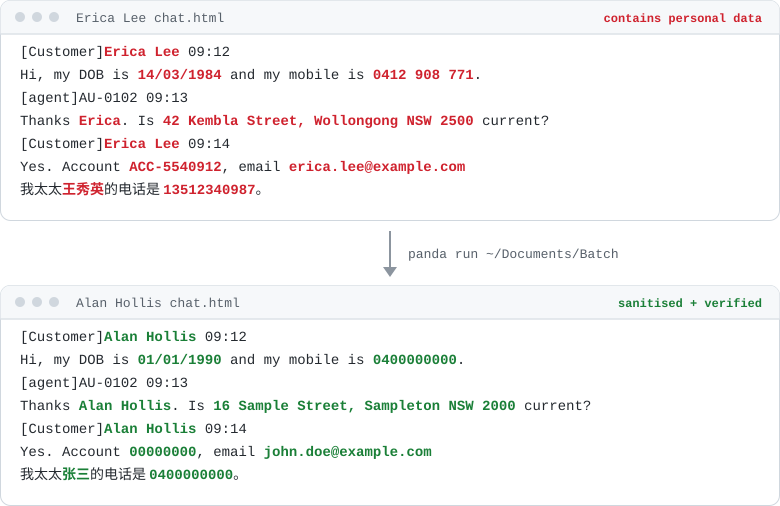
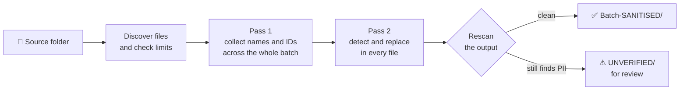
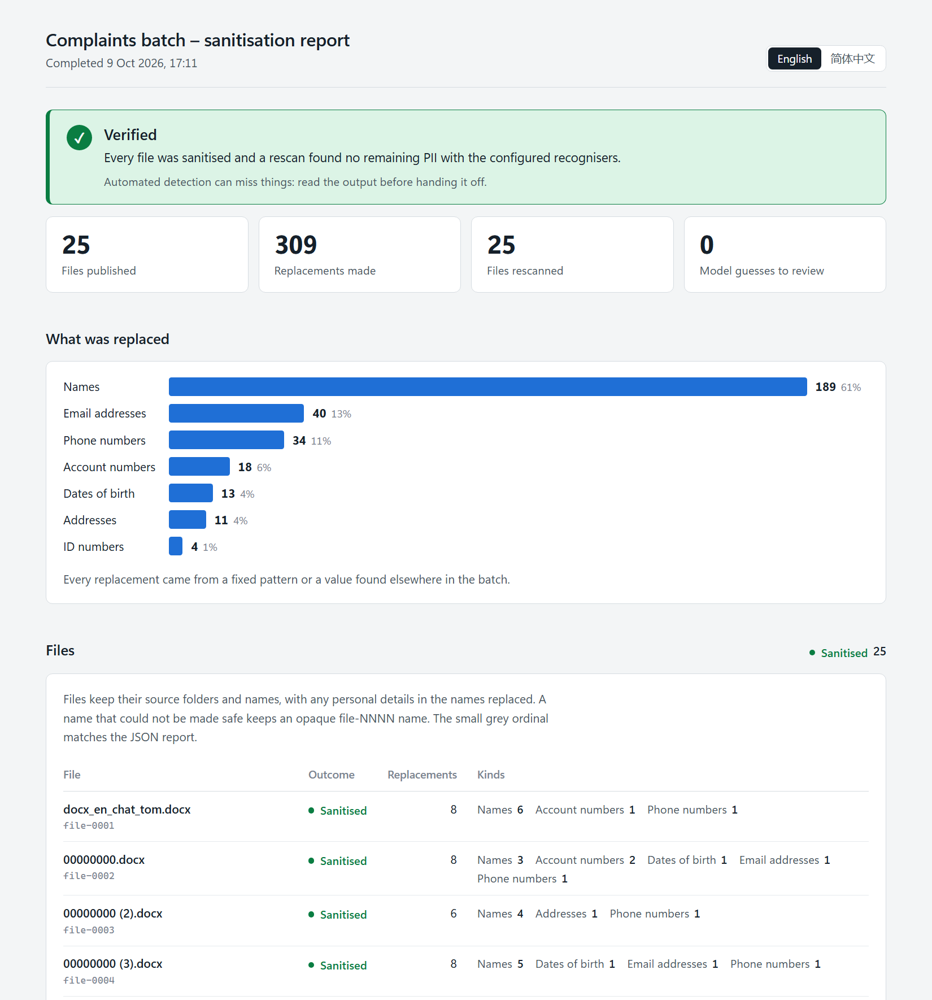

<h1 align="center">🐼 Panda</h1>

<p align="center">
  <strong>Offline PII sanitiser for English and Chinese client communications.</strong><br>
  Point it at a folder of chats, emails, letters and forms. Get back copies with every
  personal detail swapped for an obvious dummy, plus an audit report. Nothing leaves your
  machine.
</p>

<p align="center">
  
  
  
  
  <a href="LICENSE"></a>
  <a href="https://github.com/whindley5/panda/actions/workflows/ci.yml"></a>
</p>

<p align="center">
  
</p>

## About

This is a personal project and will (probably) not be getting updates; during an internship I worked on custom PII tooling for client data. A while later, for an AI/ML Engineering course at UNSW, I needed to use PII tools to clean small datasets, so I 
rewrote a simple, standalone version; used it for the class and then decided to publish it in case it's useful to anyone else :)

## What it does

- **Offline.** Panda runs on your own machine and never uploads anything. Its language
  model is installed once with Panda, never downloaded at runtime.
- **Handles messy text.** Chat exports, email threads and KYC forms, not just tidy
  sentences. Once Panda learns a name anywhere in a batch (a chat header, an email
  `From:` line, a form field), it replaces that name everywhere, including in passing
  mentions like "Thank you Sheldon~".
- **Bilingual.** It recognises English and simplified-Chinese names and addresses
  (王女士, 老王, 我叫陈凯文), Australian and Chinese phone numbers, and checksum-validated
  Chinese resident IDs, TFNs and Medicare numbers.
- **Obvious dummies.** Replacements are obviously fake (`0400000000`,
  `john.doe@example.com`, `16 Sample Street`), so nobody mistakes sanitised output for
  the real thing. A name gets the same dummy everywhere it appears in the batch.
- **Checks its own work.** After sanitising, Panda rescans its own output. If anything
  still looks like personal data, the results go into an `UNVERIFIED/` folder instead of
  being published.
- **No personal data in the report.** The audit trail records kinds, counts, positions
  and detectors, never an original value or file name.

## Quick start

```sh
# Install (Python 3.11+, Linux or macOS). pipx keeps Panda in its own environment.
pipx install git+https://github.com/whindley5/panda.git

# or use UV (faster)
uv tool install git+https://github.com/whindley5/panda.git 

# Sanitise a folder (and its subfolders)
panda run ~/Documents/Batch --html
```

```text
Panda 0.1.0 · 25 files to sanitise
  ✓ Language model ready (offline)
  ✓ Collected names and identifiers from across the batch
  ✓ Sanitised 25 of 25 files · 309 replacements
  ✓ Rescan: configured recognisers found no PII in the output
  ✓ Named outputs after their source files (PII in names replaced)

Done: all 25 files sanitised and verified.
```

The results go into a new folder beside the source. Panda doesn't change or overwrite
your source files:

```text
Batch-SANITISED/
├── Batch-files/     sanitised copies, same folders and file names (PII in names replaced)
└── Batch-report/    run.json, one file-NNNN.json per file, report.html (with --html)
```

Running Panda again creates `Batch-SANITISED-2`, and so on. The results folder is named after the source folder, so rename it before
handing it off if that name identifies a client.

<details>
<summary><strong>Other ways to install</strong></summary>

Panda's English language model (`en_core_web_md`, about 40 MB) comes from spaCy's GitHub
releases rather than PyPI. pip fetches it and checks its hash during installation, which
is the only time Panda needs internet access.

```sh
# Into an existing virtual environment
pip install git+https://github.com/whindley5/panda.git

# From a clone, with every dependency pinned to the tested versions
git clone https://github.com/whindley5/panda.git && cd panda
python3 -m venv .venv && source .venv/bin/activate
pip install -r requirements.txt .
```

Windows is not supported.
</details>

## What gets replaced

| Kind | Examples found | Replaced with |
|---|---|---|
| **Names** | full names, first names or surnames on their own, nicknames, initials used as names, spelled-out names (`K A R I M I`), chat display names (`[Customer]SheldonC`), 王女士 / 老王 / 我叫陈凯文 | a dummy name, e.g. `Alan Hollis` or `张三`; the same name gets the same dummy across the batch |
| **Phone numbers** | AU mobiles and landlines in any spacing, `(02) 9555 0143`, `+61 …`, CN mobiles and landlines, any `+country` number | `0400000000` |
| **Emails** | any address | `john.doe@example.com` |
| **Dates of birth** | `14/03/1984`, `1984-03-14`, `3-Feb-79`, `1 April 1979`, `1985年3月12日`; any full date 16+ years old, or a recent one next to a birth cue | `01/01/1990` |
| **Addresses** | AU street addresses, unit/level/PO Box, locality lines (`Box Hill VIC 3128`), CN street addresses | `16 Sample Street, Sampleton NSW 2000` |
| **Accounts & IDs** | account/customer/broker numbers, BSB, card numbers, long bare numbers, referral codes, WeChat/QQ/WhatsApp IDs | `00000000` |
| **Government IDs** | TFN and Medicare (checksum-validated), labelled passport/licence/身份证 numbers, CN resident ID (checksum-validated) | `000000000000000000` |

Panda deliberately leaves alone: staff codes such as `AU-0020`, `system` and bot speakers,
tickers, quantities, prices, recent trade dates and times, and labelled ticket or order
references. You can also tell it your organisation's name so that's left alone too (see
[Configure it for your organisation](#configure-it-for-your-organisation)).

## Supported formats

| Input | Output |
|---|---|
| `.docx` | Rebuilt `.docx` with text, tables, headers and footers. Images, tracked-change history and field codes are removed. |
| `.eml` | Sanitised message, including headers, text and HTML parts, and supported attachments. |
| `.html` / `.htm` | Plain, inert HTML paragraphs. Scripts, links, styles and images are removed. |
| `.pdf` (with a text layer) | UTF-8 transcript `name.pdf.txt`. Images are dropped; scanned or image-only PDFs are refused. |

Panda skips other files and lists them in the report.

## How it works



Detection is layered. A replacement found by a more certain layer takes priority:

| Layer | What it does |
|---|---|
| **Patterns** | Regular expressions with checksums for phones, emails, dates, addresses, accounts and IDs (`src/panda/detectors.py`) |
| **Context** | Label/value pairs in tables (a cell is checked together with its label cell and column header) and question/answer pairs in chats |
| **jieba** | Chinese word segmentation for Chinese names and street addresses |
| **spaCy** | `en_core_web_md` entity recognition for English names (`src/panda/spacy_recognizer.py`) |
| **Propagation** | Every name found anywhere in the batch, plus its likely short forms (`Raj` for Rajesh, `J. Park`), is replaced everywhere (`src/panda/propagation.py`) |

File and folder names go through the same detectors. If a name still looks identifying
after that, Panda gives it an opaque `file-NNNN` name instead. Use `--opaque-names` to give
every output file an opaque name.

### Design decisions

- **Two passes over the batch.** One file often reveals a full name ("Sheldon Cooper" in an
  email header) while another file only says "Sheldon". Collecting names across the whole
  batch first is what makes those passing mentions catchable.
- **Don't trust a single pass.** The output is rescanned with the same detectors, and
  anything suspicious is held back under `UNVERIFIED/` rather than published. Work happens
  in a private staging folder and is only moved into place once it passes, after checking
  the source hasn't changed mid-run.
- **The audit trail can't leak.** Reports record kinds, counts, positions and detectors,
  never an original value or file name, so the report is safe to share with the output.
- **Certainty wins.** When layers disagree, a checksummed pattern beats a labelled field,
  which beats a statistical NER guess.
- **Handlers only move text.** Each format handler extracts text units and rebuilds the
  file; it never decides what's personal. Detection lives in one place, and what each
  handler is allowed to output is written down in [`docs/`](docs/) (MIME, HTML and
  dependency policies).
- **Fail closed.** Encrypted, image-only, malformed or symlinked inputs are refused with a
  specific error rather than half-processed.

## Configure it

Language models often mistake brand names for people, especially brands that are also
words or surnames. Batch-wide propagation would erase your firm's name from every
document. Tell Panda what to keep:

```sh
panda run ~/Documents/Batch --keep "Acme Brokers" --keep AcmeBot --keep 白鹤证券
```

A kept term also covers business names built on it: with `--keep "Acme Brokers"`, Panda
keeps `Acme`, `Acme Support` and `ACME TRADER`, but still replaces `Acme Zhang`. To keep
a longer list, put one term per line in a file and pass `--keep-file our-names.txt`.

If your organisation's customer numbers have their own prefix, Panda can replace them even
where nothing labels them as account numbers:

```sh
panda run ~/Documents/Batch --account-prefix AB    # replaces AB-43021998, AB 43021998, …
```

## The HTML report

Add `--html` (or run `panda report Batch-SANITISED` afterwards) for a single
self-contained page. It shows the outcome, what kinds of data were replaced, each file's
result, and every replacement, with search and filters. The page works offline and holds
exactly what the JSON reports hold: never an original value.

<p align="center">
  
</p>

## Command reference

```text
panda run FOLDER [--html] [--opaque-names] [--keep TERM] [--keep-file FILE]
                 [--account-prefix PREFIX] [--output DIR --report DIR]
panda report RESULTS                  build report.html for a finished job
panda check --output FOLDER           rescan sanitised files for anything left behind
panda --help                          every command and option
```

`python -m panda` works the same as `panda`. For scripting, `--output` and `--report`
put the two result trees into separate new folders.

<details>
<summary><strong>Exit codes</strong></summary>

| Code | Meaning |
|---|---|
| `0` | Every file sanitised and the rescan found nothing |
| `1` | Bad command or setup problem |
| `2` | Job refused; nothing published |
| `3` | Some files skipped or failed; the rest are published and verified |
| `4` | The rescan still found something; results are under `UNVERIFIED/` and may contain PII |
| `130` | Cancelled |
</details>

<details>
<summary><strong>Errors</strong></summary>

| Code | What to do |
|---|---|
| `E_UNREADABLE` | Check the file opens and the installation is complete. |
| `E_ENCRYPTED` | Provide an unencrypted PDF. |
| `E_IMAGE_ONLY` | The PDF has no text layer; OCR is not supported. |
| `E_UNSUPPORTED` | Export to a supported format. |
| `E_MALFORMED` | Re-export the document; it could not be safely parsed. |
| `E_LINKED` | Run on the real folder (`realpath FOLDER`); replace symbolic links inside it with real files. |
| `E_CAPACITY` | Split the job. Limits are 16 MiB per file, and 1,000 files or 256 MiB per run. |
| `E_PERMISSION` / `E_DISK` | Check permissions and free space; use fresh destinations. |
</details>

## How accurate is it?

> [!IMPORTANT]
> Automated detection reduces risk; it cannot prove a document is free of personal data.
> **Review sanitised output before you send it to anyone else**, especially free-text
> notes about relatives, nicknames or misspellings.

Measuring it against three synthetic corpora of realistic chats, emails, letters and
forms (see `tests/fixtures/`). I tuned on the first, checked against
a holdout, and then wrote a blind set that I didn't look at until the first run, to get a
fair number:

| Corpus | Documents | Personal values surviving | Business text wrongly removed |
|---|---:|---:|---:|
| Realistic (tuning set) | 25 | 0 / 206 | 0 / 67 |
| Holdout, first run before tuning | 28 | 32 / 326 | 8 / 148 |
| Holdout, now | 28 | 0 / 326 | 0 / 146 |
| **Blind, first run, untouched** | 36 | **37 / 440** | **70 / 251** |
| Blind, after fixing the categories it exposed | 36 | 1 / 440 | 1 / 251 |

About **92% of personal values caught**. I then fixed every category that run exposed in
general form, rather than patching individual examples:

- derived nicknames (`Raj` for Rajesh)
- initial-and-surname aliases (`J. Park`)
- joined hyphenated given names (`Minjun` for Min-jun)
- Hong Kong and mainland Chinese addresses written in English
- oddly spaced phone numbers

The later blind figure is therefore optimistic. The one remaining survivor is a name that
is also a common word (`Will Price`). A test now holds the blind set at these figures, so
a regression fails CI. 

\*To note: this tool performs significantly better on *Australian* based information (ph numbers, address formats, etc). Some of the blind testing included foreign based datasets to be safe (reflected in results). 

**Known gaps:**

- tricky names:
	- names that are also common words
	- a misspelt name mentioned only while correcting it
	- nicknames that are neither a common short form nor the first syllable of a name found elsewhere in the batch
- scanned PDFs (no OCR)
- languages other than English and Simplified Chinese (clearly)


## Development Cycle

Panda began as text-only detection. I then added `.docx`, `.eml`, HTML and PDF handlers,
followed by rounds of accuracy work against the corpora above. Using an LLM judge review of the
repository drove a round of fixes (not stricly impacting usability); reliability, security and performance fixes: CI on Linux
and macOS, a clearer error for symlinked paths, splitting up the main run function, a
larger pool of dummy names, and fewer full rescans of the output. Details in
[CHANGELOG.md](CHANGELOG.md).

## Development

```sh
git clone https://github.com/whindley5/panda.git && cd panda
python3 -m venv .venv && source .venv/bin/activate
pip install -r requirements-dev.txt -e .

ruff check .
pytest                                                # unit tests and the corpus gates
python scripts/realistic_eval.py --fixture blind      # per-file survivor report
```

Detection lives in `src/panda/detectors.py`, `spacy_recognizer.py` and `propagation.py`.
Format handlers in `src/panda/handlers/` only extract and rebuild text. The synthetic
corpora are written for a fictional firm, Crane Brokers (白鹤证券), whose keep terms are
in `tests/fixtures/keep.txt`. Tests are not installed with the package. Fixtures are
always invented; never real documents, not even lightly edited ones.

If you find something Panda reliably misses, an issue with an invented example is welcome.

## Licence

[MIT](LICENSE) © 2026 William Hindley
